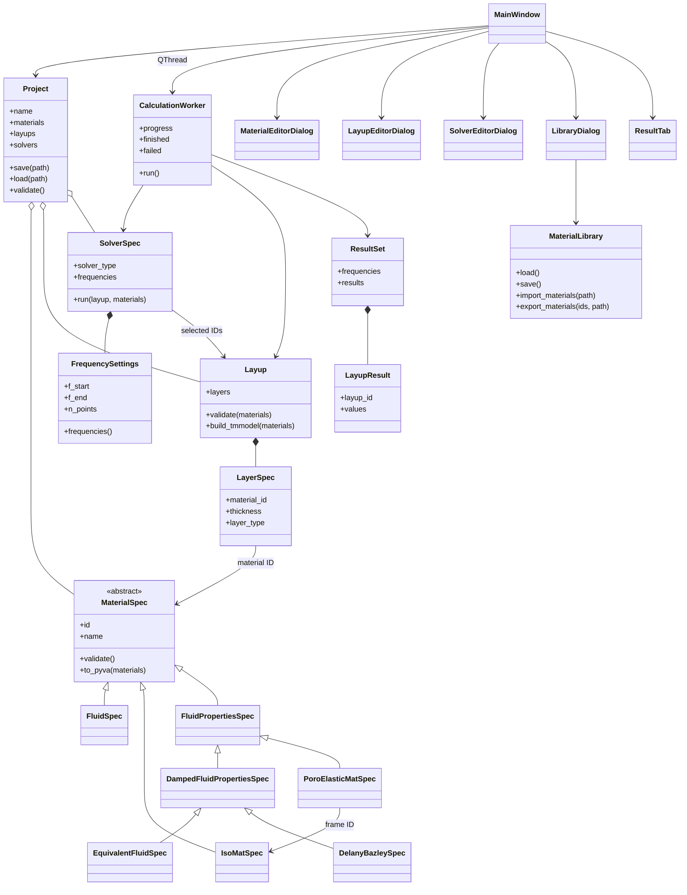
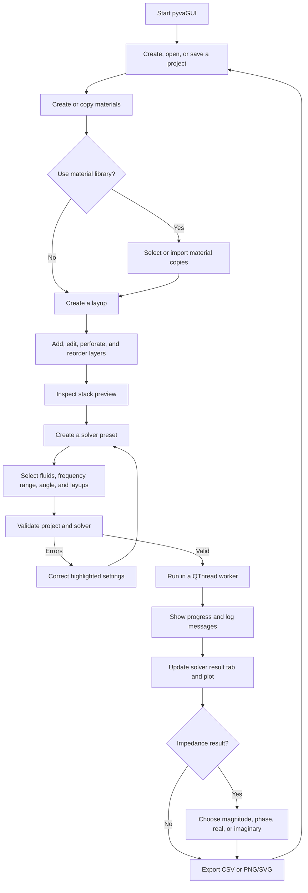

# pyvaGUI Architecture and Workflow

## Purpose

pyvaGUI is a PyQt6 desktop application for configuring infinite-layer
models and running calculations with pyva. The project model stores
materials, ordered layups, and solver settings. Calculated arrays remain
in memory and are displayed or exported separately.

## Architecture

### Layered responsibilities

- `pyvagui.model` contains plain Python specifications, validation,
  serialization, and pyva conversion. It never imports PyQt6.
- `pyvagui.services` handles work that crosses the GUI boundary, such as
  calculation workers and file export.
- `pyvagui.gui` presents model objects, collects input, and sends user
  actions to the model or services.
- The GUI edits copies in dialogs and commits them only after validation.
  The project model remains the source of truth for tree and table views.

## User Workflow

## Data and Units

- Project files use the `.pyvagui` extension and contain the existing JSON
  structure with `format_version: 1`, materials, layups, and solvers. The
  extension changes; the serialized project content does not. Files do not
  store window state or calculated results.
- The material library is stored separately under
  `%APPDATA%/pyvaGUI/library.json` on Windows or `~/.pyvagui/library.json`
  on other platforms. Missing libraries are initialized from bundled
  materials.
- Physical model values use SI units. Layup and perforation length fields
  display millimeters in the GUI and convert to meters before saving.
- Frequency samples preserve start, end, and point count with logarithmic
  spacing; they are not necessarily exact third-octave center frequencies.
- Solver angles are entered in degrees and converted to radians at the
  pyva boundary. Diffuse solvers default to a maximum angle of 78 degrees.

## Verification

Run the complete suite with `python -m pytest` and check style with
`flake8`. Model tests exercise serialization, validation, library file
operations, and all six pyva solver methods. GUI tests use pytest-qt and
temporary directories; they cover project workflows, editor dialogs,
worker signals, plotting, and exports.
